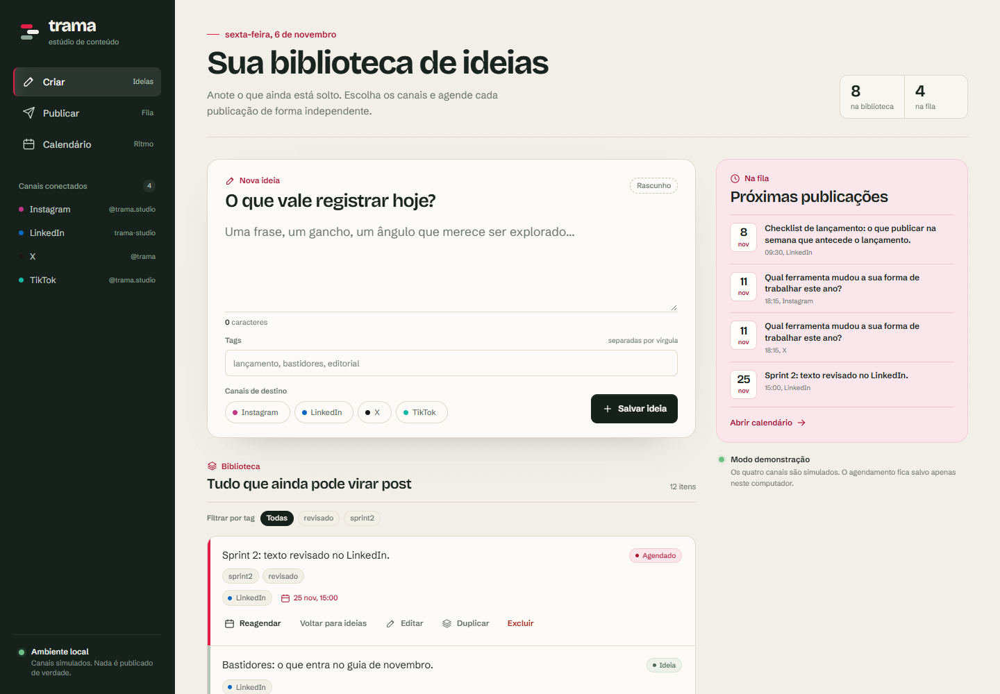
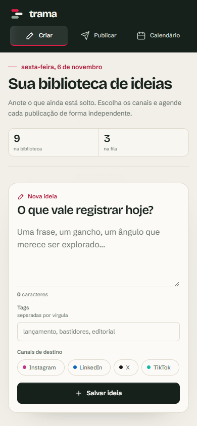
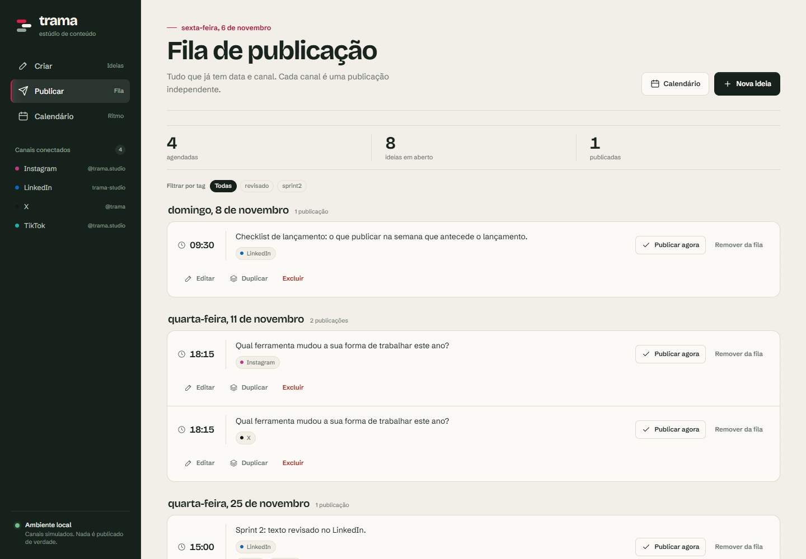
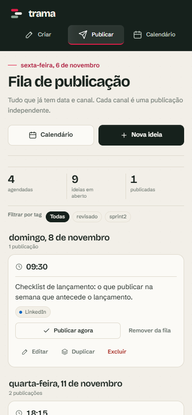
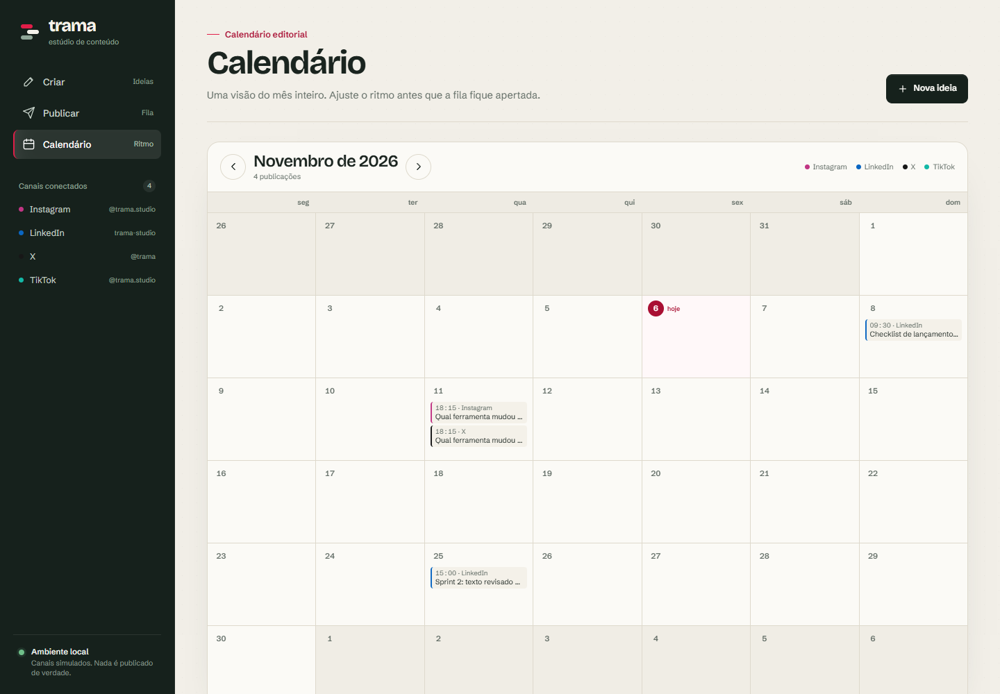
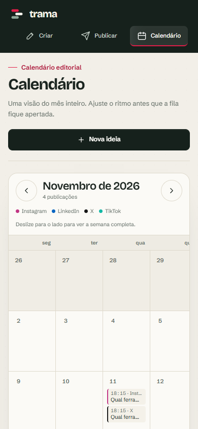
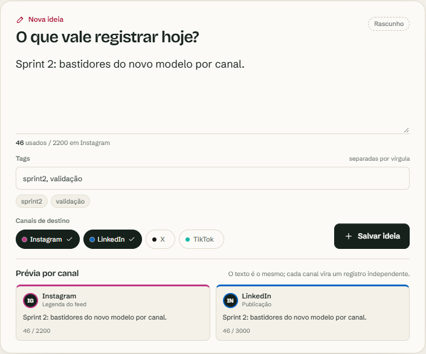
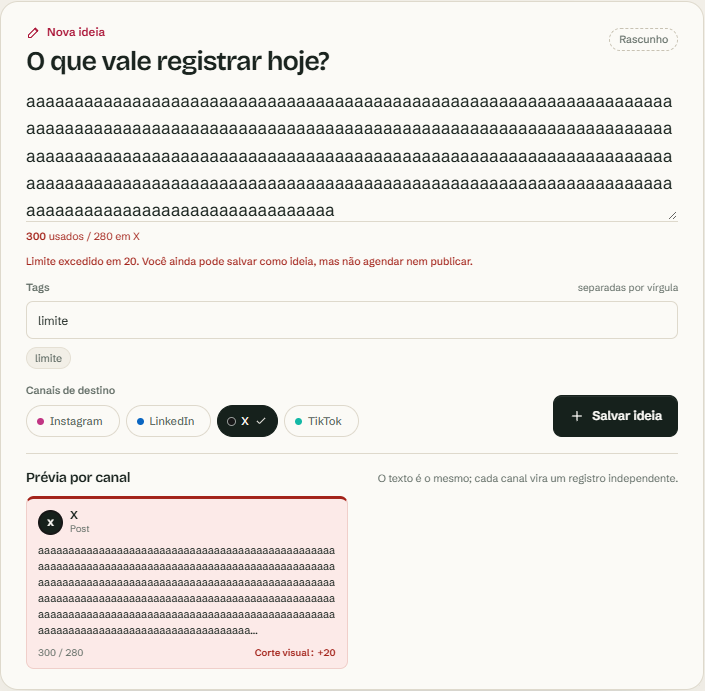
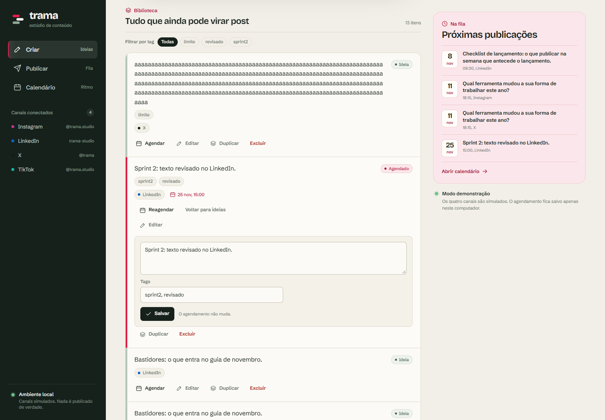

<!--
  ┌──────────────────────────────────────────────────────────────────────┐
  │  TRAMA — workspace local de conteúdo para redes sociais              │
  │  Repo: https://github.com/TayronSilva/trama                          │
  └──────────────────────────────────────────────────────────────────────┘
-->

<div align="center">

# 🧵 Trama

**Um workspace local para criar, agendar e organizar publicações — sem conta, sem OAuth, sem nuvem.**

*Biblioteca de ideias, fila de publicação, calendário visual e prévia por canal. Tudo salvo no seu computador.*


</div>

---

## 📸 Como fica

### Criar ideia e agendar

| Desktop | Mobile |
| :---: | :---: |
|  |  |

### Fila de publicação

| Desktop | Mobile |
| :---: | :---: |
|  |  |

### Calendário mensal

| Desktop | Mobile |
| :---: | :---: |
|  |  |

### Prévia e limite por canal

| Prévia do compositor | Limite excedido |
| :---: | :---: |
|  |  |

### Edição inline



---

## ✨ Funcionalidades

### 📥 Create — biblioteca de ideias
- Captura rápida de ideias com seleção de canais (Instagram, LinkedIn, X, TikTok — simulados)
- Tags separadas por vírgula, normalizadas e filtráveis
- Agendamento inline direto da biblioteca
- Editar, duplicar e excluir (com confirmação em dois passos)

### 📤 Publish — fila de publicação
- Fila agrupada por dia, com hora, canal e tags
- Publicar agora ou remover da fila
- Cada canal é **uma publicação independente** — publicar Instagram não toca o LinkedIn

### 📅 Calendar — visão mensal
- Grade mensal com navegação, botão "Hoje" e suporte a `?mes=YYYY-MM`
- Posts posicionados por dia

### 🛡️ Regras inteligentes
- **Um registro por canal:** selecionar 3 canais gera 3 publicações independentes
- **Limites por canal:** X 280 · Instagram 2.200 · LinkedIn 3.000 · TikTok 2.200
- Contador ao vivo, prévia com corte visual e bloqueio de agendamento/publicação acima do limite
- Migração automática e idempotente com backup antes de alterar o schema

### 🔒 100% local
- Banco SQLite em `data/trama.db` (WAL), sem servidor externo
- Sem autenticação, sem telemetria, sem rede — seus dados não saem da máquina

---

## 🚀 Como rodar

```powershell
npm install
npm test        # 21 testes (node --test)
npm run dev     # http://localhost:3000
```

Produção:

```powershell
npm run build
npm start
```

---

## 🗺️ Roadmap

| Sprint | Estado |
| --- | --- |
| **Sprint 1 — MVP** | ✅ Create → Publish → Calendar completo |
| **Sprint 2** | ✅ Um registro por canal, tags, limites e prévia por canal, edição/duplicação/exclusão |
| **Sprint 3 — IA opcional** | 🔜 Adaptar texto por canal + 3 aberturas (Gemini), botão desabilitado sem chave |
| Futuro | Kanban, threads, primeiro comentário, insights locais |

---

## 🛠️ Stack

| Camada | Tecnologia |
| --- | --- |
| Framework | Next.js 16.4.5 (App Router) + React 19.3.1 |
| Banco | SQLite via `node:sqlite` (DatabaseSync) |
| Datas | Strings locais `YYYY-MM-DDTHH:mm` (sem drift de fuso) |
| Testes | `node --test` (21 testes) |
| Validação | Playwright CLI (fluxo completo, desktop + mobile) |

---

## 📁 Estrutura

```
.
├── app/              # páginas e server actions
├── components/       # Composer, PostTools, Tags, Chrome, Sidebar
├── lib/              # store (SQLite), channels, dates, tags
├── test/             # testes de store e datas
├── data/             # banco local (ignorado pelo git)
├── assets/           # screenshots e imagens do projeto
├── tasks/            # plano e todo da implementação
└── design-system/    # tokens e guia visual "trama"
```

---

## 📝 Notas

- Os canais são **simulados** — nada é publicado de verdade em rede social.
- Um repositório local pessoal. Sem licença pública definida ainda.
